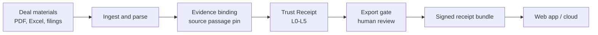
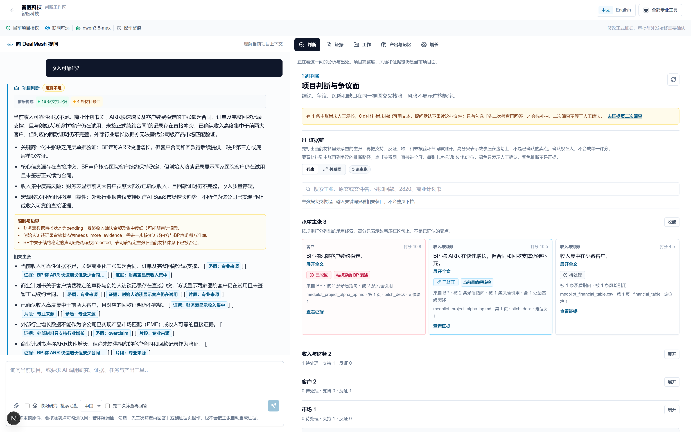
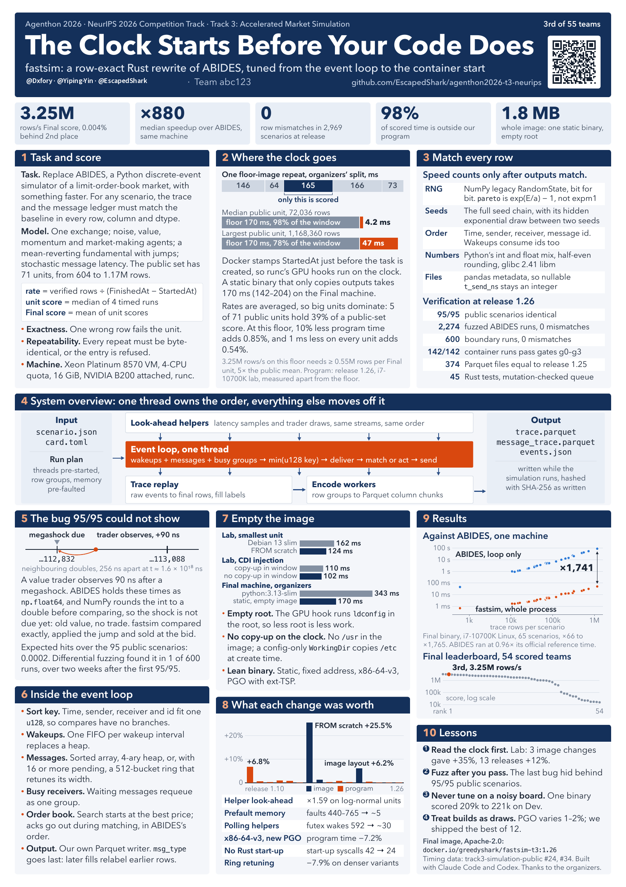

<h1 align="center">Zheng Xing · 邢政</h1>

 <b>Engineer &amp; Quant Trader · Founder of DealMesh · Kaggle Gold (9/3,856) · NeurIPS 2026 Agenthon T3 Prize (3/55) · JoinQuant research Sharpe 2.499</b> 
 <b>工程师 &amp; 量化交易员 · DealMesh 创始人 · Kaggle 金牌（9/3,856）· NeurIPS 2026 Agenthon T3 获奖（3/55）· 聚宽研究回测 Sharpe 2.499</b>

 
 
 
 

## ⚡ Highlights · 亮点

- 🥇 **Kaggle team gold — 9th / 3,856 (top 0.23%)** · Home Credit — Credit Risk Model Stability · certificate issued to X. Dxfory · Kaggle 团队金牌
- 🏆 **NeurIPS 2026 Competition Track — Agenthon T3 Prize, 3rd / 55** · Team abc123 · T2 8th/87 · T4 26th/63 · T1 48th/61 · T3 获奖、四赛道参赛
- 📈 **Huatai Securities factor research — Rank IC 0.080–0.100 · long–short Sharpe up to 3.23** · CSI 1000 · internship research backtest · 华泰中证 1000 多因子实习研究回测
- 📊 **JoinQuant research backtest — Sharpe 2.499 · return 70.90% · annualized 73.56% · excess 37.00% · max drawdown 20.11%** · benchmark 399101.XSHE return 24.74% · alpha 0.521 · beta 0.810 · ¥100,000 · 2024-11-15 → 2025-11-15 · 聚宽研究回测
- ⚡ **fastsim — 880× median same-machine speed-up** · row-exact Rust rewrite of ABIDES · Team abc123 · Rust 市场仿真
- 🔌 **edgar-mcp — shipped on [PyPI](https://pypi.org/project/edgar-filings-mcp/1.1.3/) + [MCP Registry](https://registry.modelcontextprotocol.io/v0.1/servers?search=io.github.Dxfory/edgar-mcp)** · SEC filings for AI agents, every number cited
- 🚀 **DealMesh — Private beta · public sign-up opening soon · 452 commits · 3,286 passing tests** · Trust Receipts for PE/VC research & due diligence · 内测中 · 即将向公网开放注册
- 🧪 **QBX — hundreds of platform-certified strategies across US + A-share, L1/L2 data** · 美股 + A 股数百条平台认证策略
  - Currently contributing to QBX's ongoing platform refinement and financial-agent development. · 目前参与 QBX 的后续完善与金融 agent 构建。

> **I build evidence-grounded AI systems for finance — agents, models, and research infrastructure from the first pipeline to a shipped product.**
> **我做有出处的金融 AI：智能体、模型与研究基础设施，从第一条数据管道做到可交付产品。**

---

## 🧭 Capabilities · 能力一览

| # | Dimension · 维度 | Evidence · 证据 |
|---|---|---|
| 1 | **Strong coding · 强工程** | Authored and shipped [edgar-mcp](https://github.com/Dxfory/edgar-mcp) — PyPI [1.1.3](https://pypi.org/project/edgar-filings-mcp/1.1.3/) + [MCP Registry](https://registry.modelcontextprotocol.io/v0.1/servers?search=io.github.Dxfory/edgar-mcp), offline test suite in CI, trusted-publishing release pipeline. DealMesh, built since May 2026: **452 commits · ~210,000 lines of Python · ~46,000 lines of TypeScript · 369 test files · 3,286 passing tests**. Team abc123 rebuilt ABIDES in Rust ([fastsim](https://github.com/EscapedShark/agenthon2026-t3-neurips)) — row-exact, median **880×** · 独立发布 edgar-mcp；DealMesh 自 2026 年 5 月以来 452 次提交、约 21 万行 Python + 4.6 万行 TypeScript、369 个测试文件、3,286 个测试通过；团队 Rust 重写市场仿真，逐行一致、中位 880× |
| 2 | **Agent building · 智能体构建** | **Agenthon 2026 (NeurIPS 2026 Competition Track)** — verifiable AI agents for quantitative finance and financial-semantics processing. Team abc123 competed across all four tracks and took the T3 Prize ([3rd/55](portfolio/agenthon.md), official score 3,249,452.2547; [public repo](https://github.com/Dxfory/neurips-2026-agenthon)), with T2 Forecasting 8th/87, T4 Explainability 26th/63, and T1 Coding 48th/61; team poster scheduled for the NeurIPS Agenthon Workshop, Atlanta, 12 December 2026. Published [edgar-mcp](https://github.com/Dxfory/edgar-mcp) so Cursor and Claude cite SEC filings. Strategy-factory campaigns run **4 parallel** LLM collectors (configured ceiling **6**). [DealMesh](portfolio/dealmesh.md) routes **11** model tasks behind an **8M-token** project budget cap, and scores an evidence-match set of **514** cases (**494** scored) against a release gate of Cohen's **κ ≥ 0.75** on human-adjudicated labels · NeurIPS 2026 Agenthon 四赛道参赛、T3 获奖（第 3/55）；已发布 MCP；策略工厂 4 路并行采集；DealMesh 11 条模型任务、8M token 项目预算帽、514 例证据匹配评测 |
| 3 | **Model training · 模型训练** | [5machine_learning](https://github.com/Dxfory/5machine_learning): 5-model rolling ensemble (LightGBM · XGBoost · SVR · RF · Linear) on ~79 factors, regime-adaptive 24/36/48-mo windows, retrain every **~60 trading days (≈ quarterly)**. Kaggle **Home Credit — Credit Risk Model Stability** team gold (9/3,856): time-aware grouped cross-validation and hand-built features are the training design behind the public inference stack. Agenthon **T2 Forecasting 8th/87** (Team abc123) · 五模型滚动训练；Kaggle 团队金牌背后的训练设计是时间感知分组交叉验证与手工特征；Agenthon 预测赛道 8/87 |
| 4 | **Model understanding · 模型理解** | Agenthon **T4 Explainability track 26/63** (Team abc123). Model stability under temporal drift (Kaggle Credit Risk *Model Stability*). Combined-loss weighting that penalizes decaying models; factor neutralization and correlation clustering (\|ρ\|>0.6); independent re-implementation matching to IC corr **0.998**. Temporal network motifs on stablecoin flows ([repo](https://github.com/Dxfory/Understanding-cryptocurrency-transactions-with-network-motifs)) · 模型可解释性赛道 26/63；时间漂移下的模型稳定性；独立复现 IC 相关 0.998；稳定币时序 motif |
| 5 | **0→1 systems · 从 0 到 1** | **DealMesh — Private beta · public sign-up opening soon.** Trust Receipts (L0–L5) for PE/VC research and due diligence: data pipeline → evidence binding → export gate → signed receipts → web app → cloud. FastAPI · Celery · PostgreSQL/pgvector · Redis · React/Vite · Docker · Alibaba Cloud. Since May 2026: **452 commits · ~210,000 lines of Python · ~46,000 lines of TypeScript · 369 test files · 3,286 passing tests**. Demand validation via **20+** PE/VC institution interviews. Huatai Chuangxing Global CEO Accelerator · 内测中，即将向公网开放注册；可信投研基础设施全链路自建；工程规模如上；20+ 家机构访谈完成需求验证 |
| 6 | **Strategy systems · 策略体系 (QBX)** | Cross-market factor and data research across **US / HK / A-shares × L1 / L2 / L3**. Hundreds of platform-certified strategies across US and A-share markets, on L1/L2 data. **1,700+ backtests run through the research pipeline across the QBX platform and an in-house strategy factory.** **690+ structured strategy IRs from the same research pipeline.** Platform scale: **22** datasets, **3,101** strategies, **129** sweep experiments, A-share L2 **1,072** training results (best Sharpe **1.29**). Engine aligned to the platform reference (Sharpe **1.0814** vs **1.0820**); Deflated Sharpe ≥ 0.95 gates; independent re-implementation IC corr **0.998** · 美股与 A 股 L1/L2 上的数百条平台认证策略；研究管线 1,700+ 回测与 690+ IR；引擎对齐与门控验证 · [qbx](portfolio/qbx.md) |
| 7 | **Strategy optimization · 策略优化** | JoinQuant research backtest, benchmark **399101.XSHE**, initial capital **¥100,000**, 2024-11-15 → 2025-11-15. v1 → v2: Sharpe **2.033 → 2.499**, return **58.49% → 70.90%**, annualized **60.69% → 73.56%**, excess **27.05% → 37.00%** against a benchmark return of **24.74%**, max drawdown **23.49% → 20.11%**. v2 alpha **0.521**, beta **0.810** — [screenshots](https://github.com/Dxfory/5machine_learning). Toolkit: quantile portfolios, full cost model (commission · impact · stamp duty), Newey–West, parameter-plateau and holdout gates · 聚宽研究回测 v1→v2：Sharpe 2.033→2.499、收益 58.49%→70.90%、超额 27.05%→37.00%、最大回撤 23.49%→20.11%，初始资金 ¥100,000 |
| 8 | **Trading · 交易能力** | Huatai Securities — CSI 1000 multi-factor: Rank IC **0.080–0.100**, long–short Sharpe **2.57–3.23** (internship research backtest). 2026 Hong Kong Quant Trading Championship, live-trading track, active participant. Strategy research, trading-system connectivity, and risk controls for that live book · 华泰证券中证 1000 多因子研究回测；2026 香港量化交易大赛实盘组在赛选手，工作覆盖策略研究、交易系统接入与该实盘账簿的风险控制 · [赛事页](https://fundconnecthk.com/quant-league/) |
| 9 | **Collaboration · product · network · 协作/产品/网络** | Team abc123 — Agenthon 2026 **T3 Prize 3rd/55**, T2 8th/87, T4 26th/63, T1 48th/61; team poster scheduled for the **NeurIPS 2026 Agenthon Workshop (Atlanta, 12 December 2026)**. Kaggle team gold **9th/3,856**. Demand validation via **20+** PE/VC institution interviews. Selected into Huatai Chuangxing Global CEO Accelerator. EY ITDD — retail / e-commerce / omnichannel · NeurIPS 2026 workshop 海报；团队竞赛、机构访谈、加速营、尽调一线 |

---

## 📌 Signature metrics · 标志性指标

| Metric · 指标 | Value · 数值 | Type · 类型 | Evidence · 证据 |
|---|---|---|---|
| Rank IC (CSI 1000) | **0.080–0.100** | Internship research backtest · 实习研究回测 | Huatai Securities quant internship · 华泰证券量化实习 |
| Long–short Sharpe (CSI 1000) | **2.57–3.23** | Internship research backtest · 实习研究回测 | Same · 同上 |
| JoinQuant ensemble Sharpe (v2.0) | **2.499** | Research backtest · 研究回测 | [5machine_learning](https://github.com/Dxfory/5machine_learning) · 399101.XSHE · 2024-11-15 → 2025-11-15 · return 70.90% · annualized 73.56% · excess 37.00% vs benchmark 24.74% · alpha 0.521 · beta 0.810 · max drawdown 20.11% · ¥100,000 · [v2.0.png](https://github.com/Dxfory/5machine_learning/blob/main/v2.0.png) |
| JoinQuant ensemble Sharpe (v1.0) | **2.033** | Research backtest · 研究回测 | Same window · return 58.49% · annualized 60.69% · excess 27.05% · max drawdown 23.49% · ¥100,000 · [v1.0.png](https://github.com/Dxfory/5machine_learning/blob/main/v1.0.png) |
| Kaggle team gold | **9th / 3,856** | Team competition · 团队竞赛 | [certificate](portfolio/assets/kaggle-gold-certificate.png) issued to X. Dxfory · 2024-05-28 · Home Credit — Credit Risk Model Stability |
| Agenthon 2026 T3 | **3rd / 55** | Team competition · 团队竞赛 | [agenthon.net](https://www.agenthon.net/) · Team abc123 · score 3,249,452.2547 · T3 Prize |
| Agenthon T2 / T4 / T1 | **8th / 87** · **26th / 63** · **48th / 61** | Team competition · 团队竞赛 | Same team · Forecasting · Explainability · Coding · Final, read 2026-11-09 |
| Agenthon venue | **NeurIPS 2026 Competition Track** | Team competition · 团队竞赛 | [agenthon.net](https://www.agenthon.net/) · poster for the workshop, Atlanta, 12 December 2026 |
| fastsim speedup | **880×** median | Team engineering · 团队工程 | [poster](portfolio/assets/agenthon-2026-t3-poster-team.png) · ABIDES loop vs fastsim whole process · 65 scenarios · 66–1,765× range · official Final score 3,249,452.2547 |
| Engine alignment Sharpe | **1.0814** vs **1.0820** | System verification · 体系核验 | QBX local interpreter vs platform reference · [qbx](portfolio/qbx.md) |
| Independent re-impl IC corr | **0.998** | System verification · 体系核验 | QBX second implementation · 同上 |
| Research-pipeline backtests | **1,700+** | Research pipeline · 研究管线 | 1,700+ backtests run through the research pipeline across the QBX platform and an in-house strategy factory |
| Structured strategy IRs | **690+** | Research pipeline · 研究管线 | 690+ structured strategy IRs from the same research pipeline |
| DealMesh engineering | **452** commits | Product engineering · 产品工程 | ~210,000 lines of Python · ~46,000 lines of TypeScript · 369 test files · 3,286 passing tests · since May 2026 |
| Institution interviews | **20+** PE/VC | Demand validation · 需求验证 | Demand validation via 20+ PE/VC institution interviews · Huatai Chuangxing Global CEO Accelerator |

---

## 🚀 DealMesh — Trust Receipts for PE/VC research & due diligence

**Private beta · public sign-up opening soon** 
**内测中 · 即将向公网开放注册**

**DealMesh — Trust Receipts for PE/VC research and due diligence. Built 0→1 since May 2026: 452 commits, ~210,000 lines of Python, ~46,000 lines of TypeScript, 369 test files, 3,286 passing tests. Demand validation through 20+ PE/VC institution interviews. Huatai Chuangxing Global CEO Accelerator.**

**The product · 产品：** DealMesh attaches a verifiable **Trust Receipt** to every research conclusion — pinned to the source passage and graded **L0–L5**.
DealMesh 为每条投研结论生成可核验的 Trust Receipt：定位原文，并按 L0–L5 分级证据充分度。

**The problem · 痛点：** In due diligence, the question that decides the work is whether a conclusion is supported by the source passage — the question I worked through on ITDD deals at EY.
尽调里决定工作质量的问题，是这条结论能否由原文段落撑住——我在安永 ITDD 项目里直接面对过这个问题。

- 🛠️ **Built 0→1:** data pipeline → evidence binding → export gate → signed receipts → web app → cloud deploy
- ⚙️ **Engineering scale · 工程规模:** 452 commits since May 2026 · ~210,000 lines of Python · ~46,000 lines of TypeScript · 369 test files · 3,286 passing tests
- 🤝 **Demand validation · 需求验证:** 20+ PE/VC institution interviews in China and abroad
- 🌏 Markets: Mainland China · Hong Kong · Singapore
- 🏆 Selected into **Huatai Chuangxing Global CEO Accelerator** · 入选华泰创星全球 CEO 加速营

**Architecture · 架构**

 

 <b>DealMesh product UI · demo diligence case.</b> Chat and judgment cards are the product surface. MedPilot / 智医科技 in the screenshot are demo project names. 
 <b>DealMesh 产品界面 · 演示尽调案例。</b> 对话与判断卡片是产品界面。截图中的 MedPilot / 智医科技是演示项目名。

---

## 🤖 AI agent engineering · AI 智能体工程

 

<b>Team abc123 poster, NeurIPS 2026 Agenthon Workshop, Atlanta, 12 December 2026. T3 Prize, 3rd of 55.</b>

- **Published MCP · 已发布 MCP** — [edgar-mcp](https://github.com/Dxfory/edgar-mcp): SEC 10-K/10-Q segment revenue, BDC non-accrual, Form 4 — every figure with accession and an EDGAR URL ([PyPI 1.1.3](https://pypi.org/project/edgar-filings-mcp/1.1.3/) + [MCP Registry](https://registry.modelcontextprotocol.io/v0.1/servers?search=io.github.Dxfory/edgar-mcp))
- **Competition agents · 竞赛智能体** — Team abc123 at [Agenthon 2026](portfolio/agenthon.md) ([public repo](https://github.com/Dxfory/neurips-2026-agenthon)), NeurIPS 2026 Competition Track: T3 Prize 3rd/55, T2 8th/87, T4 26th/63, T1 48th/61, and a row-exact Rust market simulator ([fastsim](https://github.com/EscapedShark/agenthon2026-t3-neurips))
- **Parallel LLM collection · 并行采集** — strategy-factory campaigns run **4 parallel** LLM collectors, configured ceiling **6**
- **Multi-model routing · 多模型路由** — DealMesh routes **11** model tasks with call logging, usage accounting, and an **8M-token** project budget cap
- **Evaluation gates · 评测闸门** — evidence-match set of **514** cases (**494** scored); release gate requires Cohen's **κ ≥ 0.75** on human-adjudicated labels
- **Full-stack 0→1 · 全栈** — FastAPI · Celery · PostgreSQL/pgvector · Redis · React/Vite · Docker · Alibaba Cloud

---

## 📈 Quant & strategy · 量化与策略

- **Huatai Securities (华泰证券)** — CSI 1000 multi-factor research: Rank IC **0.080–0.100**, long–short Sharpe **2.57–3.23** (internship research backtest)
- **QBX strategy system** — US / HK / A-shares × L1 / L2 / L3. Hundreds of platform-certified strategies across US and A-share markets, on L1/L2 data. **1,700+ backtests run through the research pipeline across the QBX platform and an in-house strategy factory.** **690+ structured strategy IRs from the same research pipeline.** Engine alignment Sharpe 1.0814 vs 1.0820; Deflated Sharpe ≥ 0.95 gates; IC corr 0.998 · [qbx](portfolio/qbx.md)
- **A-share five-model ensemble** — JoinQuant research backtest, benchmark 399101.XSHE, ¥100,000, 2024-11-15 → 2025-11-15. v2: Sharpe **2.499**, return **70.90%**, annualized **73.56%**, excess **37.00%**, max drawdown **20.11%**, alpha **0.521**, beta **0.810**. v1: Sharpe **2.033**, return **58.49%**, annualized **60.69%**, excess **27.05%**, max drawdown **23.49%** · [5machine_learning](https://github.com/Dxfory/5machine_learning)
- **Crypto network science** — temporal motifs on USDT / USDC / DAI / UST / LUNA transfer graphs, including the May 2022 window. Lead figures: `USDT_1h_motifs_heatmap.png` and `motif_heatmap_null_model.png`
- **Competitions** — Kaggle team gold 9th/3,856 · Agenthon Team abc123 T3 Prize 3rd/55, T2 8th/87, T4 26th/63, T1 48th/61 · [2026 Hong Kong Quant Trading Championship](https://fundconnecthk.com/quant-league/), live-trading track, active participant

---

## ⭐ Featured repos · 精选仓库

| Repo | What it is |
|---|---|
| [**neurips-2026-agenthon**](https://github.com/Dxfory/neurips-2026-agenthon) | NeurIPS 2026 Agenthon · Team abc123 · T3 Prize (3/55) · financial-semantics AI agents (all 4 tracks) |
| [**fastsim** (Team abc123)](https://github.com/EscapedShark/agenthon2026-t3-neurips) | Row-exact Rust rewrite of ABIDES — NeurIPS 2026 Agenthon T3 Prize 3rd/55, median 880× |
| [**edgar-mcp**](https://github.com/Dxfory/edgar-mcp) | MCP server for SEC filings — segment revenue, BDC non-accrual, Form 4, every number cited |
| [**5machine_learning**](https://github.com/Dxfory/5machine_learning) | JoinQuant five-model research backtest — Sharpe 2.499, excess 37.00%, max drawdown 20.11%, benchmark 399101.XSHE |
| [**Understanding-crypto**](https://github.com/Dxfory/Understanding-cryptocurrency-transactions-with-network-motifs) | Temporal network-motif analysis of stablecoin transfer graphs |
| [**home-credit**](https://github.com/Dxfory/home-credit) | Inference pipeline for the Kaggle team gold, Home Credit — Credit Risk Model Stability (9/3,856) |

---

## 🧰 Tech stack · 技术栈

## 📂 Public work · 公开作品

[作品目录](portfolio/README.md) · [证据对应表](portfolio/evidence-index.md)

📫 Evidence-grounded AI agents · quant research · due diligence
