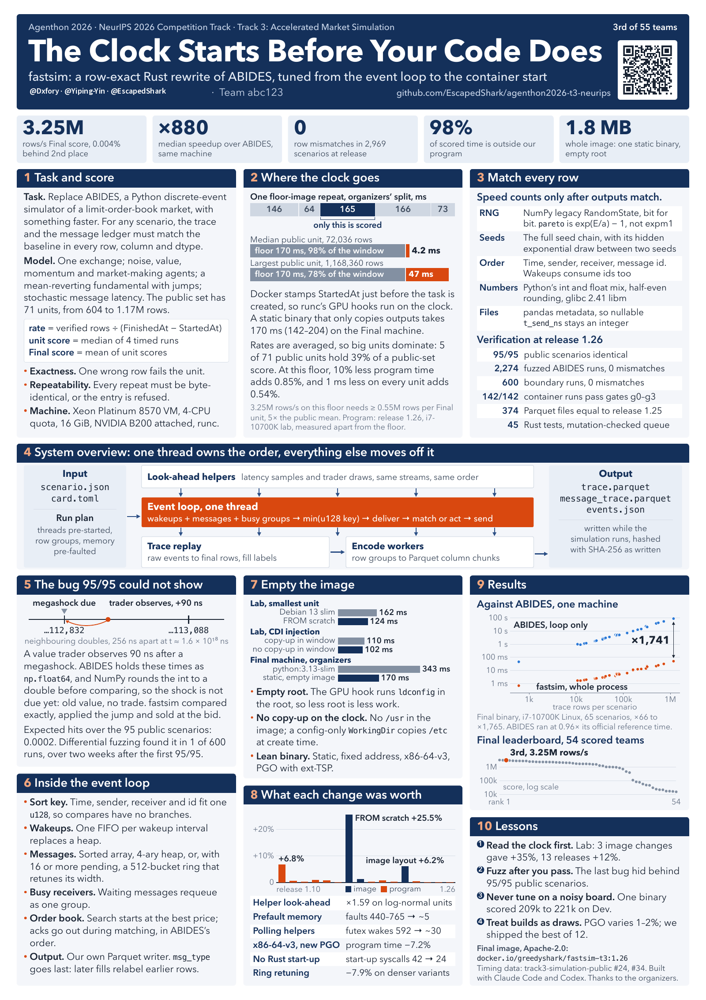

# Agenthon 2026｜Team abc123

## 做了什么

Agenthon 2026 是 NeurIPS 2026 Competition Track，主题是可验证的量化金融 AI。团队构建智能体，并做金融语义处理：预测、可解释性与市场仿真。

Team abc123（@Dxfory · @Yiping-Yin · @EscapedShark）的成绩：

- **T3 加速市场仿真**：用 Rust 重写 ABIDES 兼容市场模拟器 **fastsim**。同一个 `scenario.json` 下，trace 与 message ledger 和 Python 基线在每一行、每一列、每种 dtype 上一致，速度快约三个数量级。
- **T2 Forecasting**：金融时间序列预测。
- **T4 Explainability**：模型可解释性赛道 26/63。

团队在 T3 上的三步做法：

1. **逐行一致**：每个场景的输出可逐字节复现
2. **清空事件循环**：单线程负责事件顺序，其余工作交给辅助线程，输出不变
3. **极简镜像**：一个静态二进制、空根目录，整镜像 1.8 MB

团队海报《The Clock Starts Before Your Code Does》将于 **2026-12-12** 在亚特兰大 **NeurIPS Agenthon Workshop** 展示。

## 关键数字

| 指标 | 数值 |
|---|---|
| 赛事 | **NeurIPS 2026 Competition Track** |
| 海报 | 将于 **2026-12-12** 在亚特兰大 NeurIPS Agenthon Workshop 展示 |
| T3 加速市场仿真 | **第 3 / 55**，官网 Final 分数 **3,249,452.2547** |
| T2 Forecasting | **第 8 / 87** |
| T4 Explainability | **第 26 / 63** |
| Final 吞吐 | 约 **3.25M** verified rows/s（容器计时） |
| 同机速度 | 中位 **880×**；65 个公开场景 **66–1,765×**（Final binary · i7-10700K · Linux；ABIDES 计 simulation loop，fastsim 计整个进程） |
| 一致性 | **2,969** 个场景零行差（95 公开 + 2,274 fuzz + 600 边界） |
| 容器验证 | **142 / 142**，gates g0–g3 |
| Rust 测试 | **45** |
| Final 镜像 | **1.8 MB** |

成绩均为 Team abc123 的团队成绩。

## 链接

- 赛事官网与 Final 榜：[agenthon.net](https://www.agenthon.net/)
- 团队代码：[EscapedShark/agenthon2026-t3-neurips](https://github.com/EscapedShark/agenthon2026-t3-neurips)
- 团队海报：[agenthon-2026-t3-poster-team.png](assets/agenthon-2026-t3-poster-team.png)
