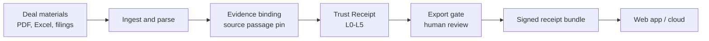

# DealMesh｜Trust Receipts for PE/VC research & due diligence

## 做了什么

DealMesh 为每条投研结论生成可核验的 **Trust Receipt**：定位到原文段落，按 **L0–L5** 分级证据充分度，经导出闸门与人工复核后签发回执。我从 0 到 1 定义产品并完成工程实现。

问题来自尽调一线：我在安永做 ITDD 时，最难回答的始终是「这条结论有没有证据撑住」。

### 产品能力
- **证据溯源**：结论 → 原文段落 → 文件版本
- **L0–L5 证据分级**：按证据充分度给每条结论定级
- **导出闸门与人工复核**：未达标的结论在导出前被拦截
- **签名回执包**：结论、证据与复核记录一起打包签发
- **权限审计**：谁在何时看过、改过、导出过什么
- **金融工作流**：PE/VC 投研、尽调、FA

### 工程
- 全链路自建：数据管道 → 证据绑定 → 导出闸门 → 签名回执 → Web 应用 → 云端部署
- 技术栈：FastAPI · Celery · PostgreSQL/pgvector · Redis · React/Vite · Docker · 阿里云
- 工程规模：自 2026 年 5 月以来 **452** 次提交 · 约 **21 万**行 Python + **4.6 万**行 TypeScript · **369** 个测试文件 · **3,286** 个测试通过（英文口径：450+ commits · ~210k lines Python + ~46k TypeScript · 369 test files · 3,286 passing tests）
- 智能体：策略工厂 campaign 以 **4** 路并行 LLM 采集（配置上限 **6**）；DealMesh 路由 **11** 条模型任务，项目预算帽 **8M token**；证据匹配评测集 **514** 例（计入评分 **494** 例），发布闸门要求人工裁定标签上 Cohen's **κ ≥ 0.75**

## 关键数字

| 指标 | 数值 |
|---|---|
| PE/VC 机构访谈 | **20+** 家（国内与海外） |
| 市场验证 | 通过 20+ 家 PE/VC 机构访谈完成需求验证 |
| 加速营 | 入选 **华泰创星全球 CEO 加速营** |
| 覆盖市场 | 中国内地 · 香港 · 新加坡 |
| 业务线 | PE/VC 金融工作流 · AI 出海 |
| 工程规模 | 450+ commits · ~210k lines Python + ~46k TypeScript · 369 test files · 3,286 passing tests |

## 链接

- 主页概览：[Dxfory](https://github.com/Dxfory)
